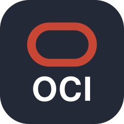

**Backend (Java / Spring Boot) · Arquitetura · CI/CD · Tech Lead**

---

### 👋 Sobre | About

🇧🇷 Engenheiro de software em sistemas **ERP corporativos**: mão na massa no código e referência técnica interna em decisões de arquitetura, CI/CD e problemas críticos de produção. Moderniza sistemas legados **sem parar a operação**, orienta outros desenvolvedores e conecta desenvolvimento, infraestrutura e entrega.

🇺🇸 Software Engineer on **enterprise ERP systems**: hands-on with the code and the internal technical reference for architecture decisions, CI/CD and critical production issues. I modernize legacy systems **without disrupting operations**, mentor developers and connect development, infrastructure and delivery.

### 💼 Trabalhe comigo | Work with me

Aberto a **projetos pontuais de freelance** | Open to **freelance projects**:

| | |
|---|---|
| 🔌 **APIs e integrações** | Java / Spring Boot e Node.js: desenho, implementação e documentação |
| ⚙️ **CI/CD** | Pipelines Jenkins e Docker; menos falhas de build, release e produção |
| 🔄 **Modernização** | Adoção gradual de Node.js, React e TypeScript em stacks legadas |
| 🔎 **Code review e consultoria** | Revisão de código, padrões de arquitetura e mentoria técnica |
| 🤖 **IA na engenharia** | Refatoração, documentação, automação e fluxos de release com IA |

📩 **me@schneiderjoao.com.br**: conte o problema e eu respondo com escopo, prazo e valor.

### 🛠️ O que faço no dia a dia | What I do

| | |
|---|---|
| 🏗️ **Arquitetura** | Defino e padronizo arquiteturas Spring Boot entre projetos |
| ⚙️ **CI/CD** | Construo e evoluo pipelines Jenkins; previno falhas de build, release e produção |
| 🔥 **Produção** | Investigo e resolvo problemas complexos em ambientes críticos |
| 🔄 **Modernização** | Adoção gradual de Node.js, React e TypeScript em stacks legadas |
| 👥 **Liderança** | Code reviews, mentoria e ponte entre tecnologia e stakeholders |

### 🧰 Stack

   
   
  
  
  

### 🎯 Foco atual | Currently focused on

`DevOps` · `Cloud infrastructure` · `Release engineering` · `Software architecture` · `Technical leadership`
