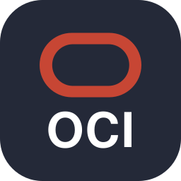

**Backend · Architecture · DevOps · Tech Lead**

---

### 👋 Sobre | About

Software Engineer working on **enterprise ERP systems** — hands-on with the code, and the **internal technical reference** for architecture decisions, CI/CD and critical production issues.

🇺🇸 Software Engineer on **enterprise ERP systems**: hands-on with the code and the internal technical reference for architecture decisions, CI/CD and critical production issues. I modernize legacy systems **without disrupting operations**, mentor developers and connect development, infrastructure and delivery.

### 🛠️ What I do

| | |
|---|---|
| 🏗️ **Architecture** | Define and standardize backend architectures across projects |
| ⚙️ **CI/CD** | Build and evolve Jenkins pipelines; prevent build, release and prod failures |
| 🔥 **Production** | Investigate and solve complex issues in critical environments |
| 🔄 **Modernization** | Gradual adoption of Node.js, React and TypeScript on legacy stacks |
| 👥 **Leadership** | Code reviews, mentoring, and the bridge between tech and stakeholders |
| 🤖 **AI in engineering** | Applying AI to refactoring, docs, automation and release workflows |

### 🧰 Stack

   
   
  
  
  

### 🎯 Foco atual | Currently focused on

`DevOps` · `Cloud infrastructure` · `Release engineering` · `Software architecture` · `Technical leadership`

---

Gotta commit 'em all.

